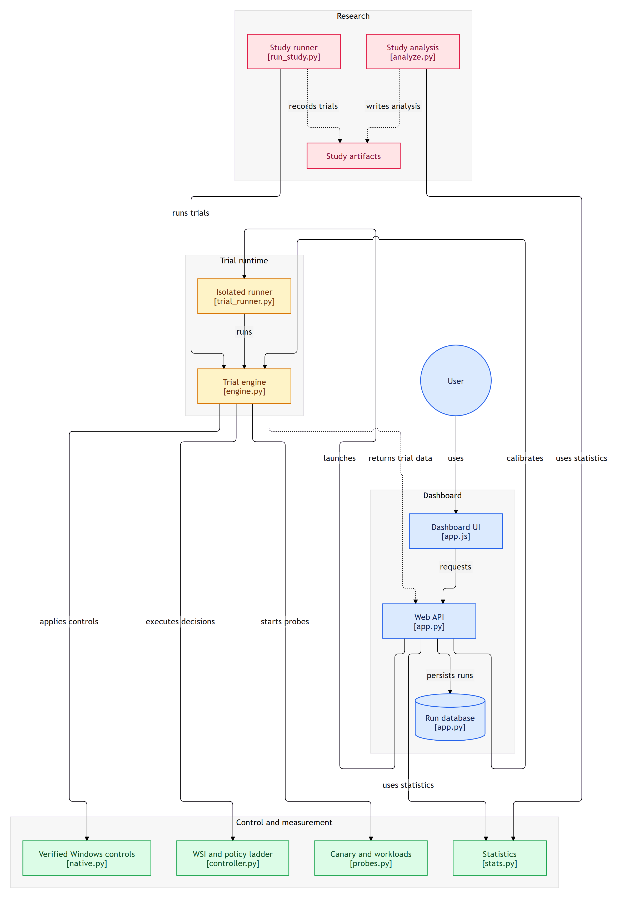

# SmartSwap

**Measuring and mitigating background interference on unmodified Windows desktops with a user-mode stall index.**

Background work (sync clients, indexers, updates, builds) slows down the app you are using, but Windows only tells software how *busy* the machine is, not how much time interactive work is *losing*. SmartSwap:

1. **Measures** that loss with the **Windows Stall Index (WSI)**: a low-duty canary process wakes every 40 ms and times its own scheduling delay, compute, memory streaming, and unbuffered disk reads. This is a PSI-style signal that needs no admin rights, drivers, or hardware counters.
2. **Names the cause** (CPU, memory bandwidth, or storage) by testing the most *specific* symptom first.
3. **Names the culprit application** (new in v3), among every process on the desktop, by experiment rather than correlation. Passive ranking picks up to 3 suspects. Then SmartSwap runs a **randomized factorial micro-experiment** on the live desktop: each suspect's priority is lowered in a random, balanced half of 8 short slots (about 5 s). A permutation test says which suspects causally raise the stall. Because the assignment is random, load that drifts mid-test cannot fool it. The measured effect is a per-application **interference bill** (ms of your time lost per second). Innocent applications are restored.
4. **Applies the cheapest fix that works**, using a ladder: lower background priority → steer background work to efficiency cores (hybrid CPUs) → EcoQoS, Windows 11's Efficiency mode → an AIMD-tuned Job Object CPU-rate cap.
5. **Proves every action twice**: Windows reads back that it took effect, and the canary confirms it helped. Otherwise it is rolled back.

It never raises a priority and reverts every change. In trials it governs the processes it started. On the live desktop it governs third-party applications only when you opt in, and then:
- it only lowers priority and I/O priority;
- it never touches the foreground app, another user's processes, or the shell, compositor, audio or antivirus;
- it journals every change, so a crashed run is undone on the next start.

## Results (one hybrid-core laptop, 460 randomised trials, 0 failures)

| Claim | Evidence |
|---|---|
| WSI tracks what the user feels | Spearman ρ = **0.96** between canary WSI and a *separate* app's p95 latency (50 observe-only trials) |
| WSI detects interference | ROC AUC **0.965–1.000**; **1.2%** false alarms on a quiet PC |
| The cause is named correctly | **92.4% / 85.8% / 99.6%** of stalled periods for CPU / memory bandwidth / storage |
| Tail latency is cut | p95 reduced by **87–94%** under CPU and mixed contention |
| E-core steering helps on hybrid CPUs | Memory-bandwidth contention: **0.73×** the p95 of the best static policy (95% CI 0.67–0.75, 8/8 blocks) |
| The ladder matters | Without it, p95 is **4.8×** worse (CPU) and **3.8×** worse (mixed) |
| Every action is real | **1,575 / 1,575** actions and **322 / 322** reverts verified by kernel read-back |

What we report honestly: plain static priority demotion is a strong baseline and ties SmartSwap on CPU and mixed contention. Without steering, v2 over-throttles under memory contention. All results come from one machine, with synthetic foreground and background workloads. With 8–10 blocks, effects are large and consistent, but no comparison survives a family-wide Holm correction.

## v3: what is new, and what still needs data

The table above is the v2 study (one machine). v3 adds the following. Each item is implemented and unit-tested, but **none of them has results until the studies below run on Windows**:

| Addition | Why a reviewer needs it | Study |
|---|---|---|
| Culprit blame: passive ranking plus interventional confirmation, for third-party processes (`backend/blame.py`, `backend/govern.py`) | Answers "it only governs its own processes". Moves from *what* is contended to *who* causes it. | `--design blame`: 4 ground-truth scenarios × {none, oracle, top-CPU, passive, interventional} |
| EcoQoS / Efficiency mode, as a baseline and as a ladder rung | Answers "Windows 11 already does this" | `--design ecoqos` |
| A real app's UI latency as the foreground: a `WM_NULL` round trip to Notepad's message pump, the same test Windows uses for "Not Responding" | Answers "synthetic foreground only". Validates WSI against an unmodified app. | `--design realapp` |
| Real tools as the background: byte-compiling the stdlib, `certutil` hashing, `Compress-Archive`, `findstr` | Answers "synthetic background only" | `--design real` |
| Multi-host pooling with a hierarchical bootstrap and host-level sign tests | Answers "one machine" | `python -m research.pool` |
| Contention fingerprinting: each PC learns how CPU, bandwidth and storage contention distort its canary; live stalls are decomposed into resource shares | Hand-ordered attribution rules do not carry across machines; mixed load needs shares, not one label | `--design attribution` (and `--fingerprint` on any design) |
| Drift simulation for blame confirmation | Shows why randomization matters | `python -m research.simulate_blame` |
| 5 pre-registered primary hypotheses (`research/hypotheses.json`); Holm runs over these only | Answers "nothing survives Holm" | `python -m research.pool` |
| Canary and blame CPU overhead; blocks needed for 80% power per comparison | Overhead and sample-size questions | every design |

`docs/PAPER_PLAN.md` gives the contribution list, the protocol, and which result supports which claim.

SmartSwap targets Windows only. `backend/posix.py` and `research/linux_study.py` are a development harness for exercising the shared controller and blame code on Linux machines; they are not part of the evaluation.

## System design



## Run it

Requires Windows 10/11 and Python 3.12+. No administrator rights are needed.

```powershell
python -m pip install -r requirements.txt
.\scripts\start.ps1            # serves http://127.0.0.1:8765
```

The dashboard has four pages:
- **Monitor:** live CPU and memory, the busiest processes, and the live stall index with its likely cause and likely culprit application. Governing is opt-in: `POST /api/live/start` with `{"govern": true, "allow": ["name.exe"]}`.
- **Experiment:** run a trial and see its controller timeline and verified action ledger, or run a paired comparison.
- **Evidence:** the study results.
- **Reports:** exports, a capability scan, and an emergency stop.

`.\scripts\run-safe-demo.ps1` runs one bounded demo trial.

## Reproduce the study

To run everything on one PC (about 5-6 hours; `-Quick` halves it) and get a zip to pool with other machines:

```powershell
.\scripts\run-v3-studies.ps1
python -m research.pool <study-dir> <study-dir> ...   # from 3+ machines: tests the pre-registered hypotheses
```

Individual designs:

```powershell
python -m research.run_study --blocks 10                          # main study (~2 h; keep the PC otherwise idle)
python -m research.run_study --design hybrid --blocks 8           # E-core steering study
python -m research.run_study --design slo-sweep --blocks 6        # protection-vs-cost frontier
python -m research.run_study --design blame --blocks 10           # culprit identification (ground truth)
python -m research.run_study --design ecoqos --blocks 10          # vs. Windows 11 Efficiency mode
python -m research.run_study --design realapp --blocks 8          # foreground = Notepad's UI latency
python -m research.run_study --design real --blocks 8             # real tools as background
python -m research.run_study --design attribution --blocks 8      # ordered rule vs. learned fingerprints
python -m research.analyze "$env:LOCALAPPDATA\SmartSwap\results\<study-id>"
```

Studies use a randomised complete block design. Analysis uses paired exact Wilcoxon tests, 95% bootstrap CIs, and Holm correction. Results, figures, and LaTeX tables are written next to each study's raw per-beat traces.

## Layout

```
backend/     probes.py (canary, probes, workloads, UI probe) · controller.py (WSI, attribution, ladder)
             blame.py (culprit ranking + interventional confirmation) · govern.py (third-party governor, blame trial)
             native.py (verified Win32/NT controls, EcoQoS) · engine.py (one trial) · app.py (API) · trial_runner.py
frontend/    dependency-free dashboard
research/    run_study.py (study harness) · analyze.py, designs.py (statistics and figures)
             pool.py (multi-host pooling) · hypotheses.json (pre-registered primary family)
scripts/     start.ps1 · run-safe-demo.ps1 · run-v3-studies.ps1 (full protocol on one PC)
tests/       pytest suite (controller, blame, statistics, pooling, API)
docs/        AUDIT_V1.md - why the v1 results were invalid
```
